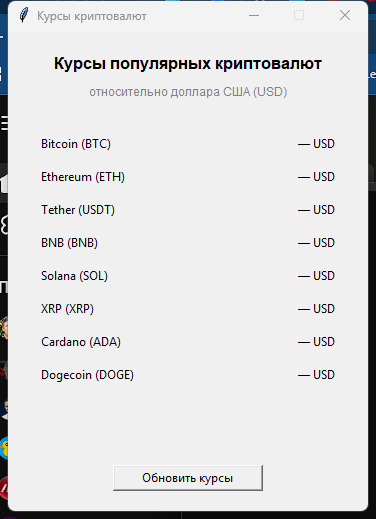

# Техническое задание  
## Приложение "Курсы криптовалют"

### 1. Цель
Создать desktop-приложение на Python с графическим интерфейсом, которое показывает текущие курсы популярных криптовалют к доллару США (USD) по данным открытого API [CoinGecko](https://www.coingecko.com/en/api).

### 2. Требования
1. Графический интерфейс на **tkinter**.
2. Отображение курсов популярных криптовалют к **USD**.
3. Получение данных через API CoinGecko в формате **JSON**.
4. Кнопка обновления курсов.
5. Обработка ошибок сети и некорректного ответа API.
6. Разработка с использованием **Git**, не менее **трёх коммитов**.

### 3. Стек технологий
| Компонент | Решение |
|-----------|---------|
| Язык | Python 3 |
| GUI | tkinter / ttk |
| HTTP | urllib.request |
| Формат данных | JSON |
| API | CoinGecko Simple Price |
| VCS | Git / GitHub |

### 4. Функциональность
- Список криптовалют: Bitcoin, Ethereum, Tether, BNB, Solana, XRP, Cardano, Dogecoin.
- Запрос: `GET /api/v3/simple/price?ids=...&vs_currencies=usd`.
- По нажатию "Обновить курсы" цены подставляются в правый столбец интерфейса.
- При сбое соединения или данных показывается окно с ошибкой.

### 5. Эскиз интерфейса

Скриншот главного окна приложения:



Схематичный эскиз:

```
┌──────────────────────────────────────┐
│  Курсы криптовалют              _ □ ×│
├──────────────────────────────────────┤
│                                      │
│   Курсы популярных криптовалют       │
│   относительно доллара США (USD)     │
│                                      │
│   Bitcoin (BTC)          — USD       │
│   Ethereum (ETH)         — USD       │
│   Tether (USDT)          — USD       │
│   BNB (BNB)              — USD       │
│   Solana (SOL)           — USD       │
│   XRP (XRP)              — USD       │
│   Cardano (ADA)          — USD       │
│   Dogecoin (DOGE)        — USD       │
│                                      │
│        [ Обновить курсы ]            │
│                                      │
└──────────────────────────────────────┘
```

После обновления (пример):

```
│   Bitcoin (BTC)       76,718.00 USD  │
│   Ethereum (ETH)       2,252.63 USD  │
│   ...                                │
```

### 6. Структура проекта
```
crypto-rates/
├── main.py         # интерфейс и логика запросов
├── interface.png   # скриншот интерфейса
├── ТЗ.md           # техническое задание (этот файл)
└── .gitignore
```

### 7. Запуск
```bash
python main.py
```

### 8. Критерии приёмки
- [x] GUI на tkinter
- [x] Курсы криптовалют к USD через CoinGecko
- [x] Данные в JSON
- [x] Эскиз интерфейса в ТЗ
- [x] Не менее трёх коммитов в Git
